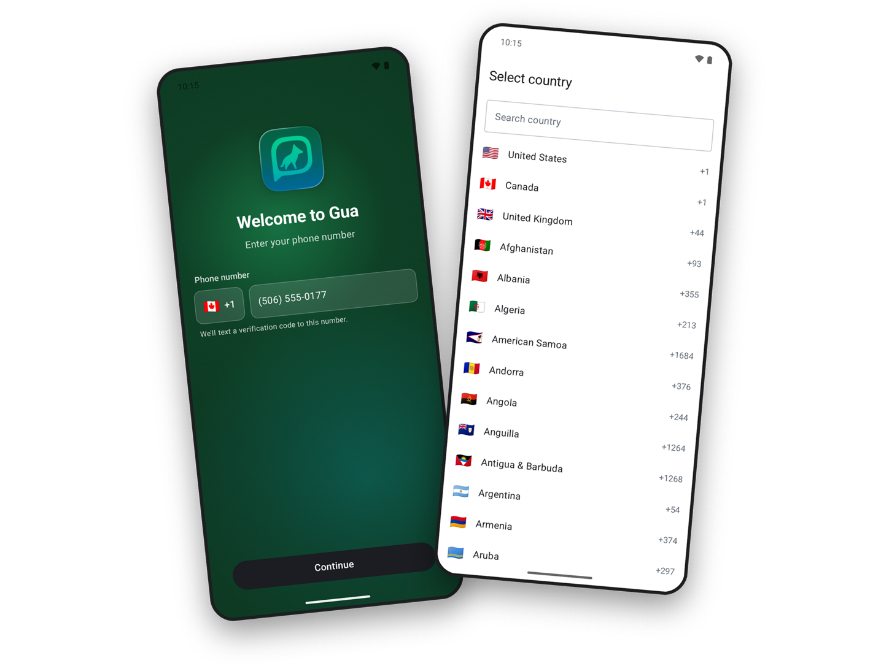

<p align="center">
  
</p>

<div align="center">

  

  <h1>Gua for Android</h1>

</div>

## What this is

**Gua** is a private messenger. End-to-end encryption is on by default. It is built on [Matrix](https://matrix.org/).

The Gua Android client is based on [`element-hq/element-x-android`](https://github.com/element-hq/element-x-android), with Gua's sign-in, routing, contact discovery, account management and interface.

## Get the app

Gua for Android is in an invite-only beta. Request access with the beta form at [gua.global/support](https://gua.global/support#beta-form). Approved testers receive installation instructions by email. The [iOS client](https://github.com/Gua-ra/gua-ios) is available through an invite-only TestFlight beta.

---

## What the app does today

- **Automatic homeserver selection.** At sign-in, the app sends your phone number to [`gua-resolver`](https://github.com/Gua-ra/gua-resolver) and connects to the returned homeserver through the Gua identity host. For new accounts, the resolver selects a homeserver using its routing policy and roster. The interface displays usernames without server addresses.
- **Two-step sign-in.** Enter your phone number and confirm a verification code, then use the account's passkey or six-digit PIN. Both steps are required. Institutional SSO is planned.
- **Contact discovery.** Find Friends lists your contacts who use Gua and makes them available in Start Chat. The app sends contact phone numbers over an encrypted connection to the Gua identity service. The service hashes the numbers in memory with a secret key, matches them to Gua accounts and discards them. Contact names remain on the device.
- **Phone number changes.** You can change the number linked to your account from Settings. The new number receives a one-time code. The account PIN is the second factor.
- **Account recovery warnings.** During delayed account recovery, every signed-in device displays a warning in the chat list with an option to cancel recovery.
- **A Gua welcome screen.** The app opens on a native welcome screen with the Gua aurora, phone entry and a country picker.

### What is different from upstream Element X

| Area | Upstream (Element X) | Gua |
|---|---|---|
| Brand | Element / New Vector | Gua (`global.gua` application id) |
| Login flow | Matrix password / SSO with manual homeserver selection | Phone number and verification code, then passkey or PIN. Automatic homeserver selection. Institutional SSO planned |
| Welcome screen | Element onboarding | Gua aurora welcome with native phone entry and country picker |
| Account home | user selects a homeserver | selected by the resolver (`libraries/guaresolver`) |
| Contact discovery | user directory search | Find Friends phone number lookups, available in Start Chat (`features/findfriends`) |
| Two-step verification | device verification | 6-digit account PIN: set, change, reset (`features/preferences` two-step verification) |
| Settings identity | full user id with server suffix | username without the server suffix |
| Chat list | all rooms, including Spaces and empty rooms | Spaces and rooms containing only state events are hidden |
| 1:1 conversations | state events visible in the timeline | configuration events are hidden |
| Sign-in session handling | may silently resume a previous web session | fresh authentication forced on every sign-in (`prompt=login`), in a private Custom Tab where the browser supports one |
| Languages | upstream translations | adds Gua pt-BR and fr strings |

### How sign-in works today

```
Gua Android app
    |  1. resolver lookup by phone number: which homeserver to use
    v
gua-resolver
    |  2. OIDC authorization code + PKCE (Custom Tab) against the resolved server
    v
Matrix Authentication Service (Gua fork: gua-auth-service)
    |  3. delegated sign-in (phone + one-time code, then passkey or PIN; institutional SSO planned)
    v
Gua Identity Service
    |  provisioning, account PIN, passkeys, contact lookup, phone-number changes
    v
Synapse homeserver in the Gua federation
```

- Before sign-in, the app requests a homeserver from [`gua-resolver`](https://github.com/Gua-ra/gua-resolver) through `libraries/guaresolver`. The client does not hardcode a server or display the federation layout.
- The app registers as a public OIDC client and requires PKCE. Sign-in requests fresh authentication with `prompt=login` and uses an ephemeral Custom Tab when supported by the browser. Account management uses the shared tab and identifies the signed-in account with `org.matrix.msc4198.login_hint`. The [Gua fork of MAS](https://github.com/Gua-ra/gua-auth-service) and the [Gua Identity Service](https://github.com/Gua-ra/identity-service) implement authentication.
- Find Friends, the account PIN and phone number changes use the Gua Identity Service API.
- End-to-end encryption stays on by default.

---

## Current limits and planned work

- **Per-homeserver authentication.** Today every sign-in completes at the single Gua identity host.
- **Routing verification.** The app checks the resolver's response against signed federation state in report-only mode, without affecting sign-in. It still uses the response as given.
- **Federation policy.** Each homeserver operator sets its Matrix federation policy: open, restricted to selected servers, or disabled. Gua's homeservers currently federate with other Matrix servers. Restricting them to roster members is planned.

[Gua identity and federation](https://github.com/Gua-ra/gua-resolver/blob/main/docs/architecture/gua-identity-and-federation.md) documents the current system. [Planned federation work](https://github.com/Gua-ra/gua-resolver/blob/main/docs/architecture/planned-federation-work.md) lists proposed changes and their requirements.

---

## Building

### Requirements

You need **Android Studio** (or the Android command line tools) and **JDK 21**.

### Build a debug APK

```bash
git clone git@github.com:Gua-ra/gua-android.git
cd gua-android
./gradlew :app:assembleGplayDebug
```

Or open the project in Android Studio and run the `app` configuration. The debug application id is `global.gua.debug`.

### Point the app at your own Gua stack

Set the `gua.*` properties in `local.properties`:

```properties
gua.resolverBaseUrl=...
gua.identityServiceBaseUrl=...
gua.defaultAccountProvider=...
```

The [contribution guide](CONTRIBUTING.md) covers setup, quality checks and tests.

---

## Reporting problems

- Bugs and requests: [open an issue](https://github.com/Gua-ra/gua-android/issues).
- Security problems: follow [SECURITY.md](SECURITY.md). Never put them in a public issue.
- Anything else: the [support form](https://gua.global/support) or [support@gua.global](mailto:support@gua.global).

---

## Upstream relationship

This repository tracks [`element-hq/element-x-android`](https://github.com/element-hq/element-x-android). To pull upstream changes:

```bash
git fetch upstream
git merge upstream/develop
```

Element X Android is the Matrix client made by [Element](https://element.io/). It uses the [Matrix Rust SDK](https://github.com/matrix-org/matrix-rust-sdk) through an FFI layer, [Jetpack Compose](https://developer.android.com/jetpack/compose) for the UI and [Appyx](https://github.com/bumble-tech/appyx) for navigation, and requires Android 7.0 (API 24) or newer. Gua inherits all of that. Element X's own store listings, translation project, community rooms and support channels are Element's and do not cover Gua.

## Copyright and License

Copyright (c) 2025 Element Creations Ltd.
Copyright (c) 2022 - 2025 New Vector Ltd.
Copyright (c) 2026 Gua (Gua modifications)

Upstream Element X Android is dual licensed by Element Creations Ltd (Element). It can be used either:

(1) for free under the terms of the GNU Affero General Public License (as published by the Free Software Foundation, either version 3 of the License, or (at your option) any later version); OR

(2) under the terms of a paid-for Element Commercial License agreement between you and Element (the terms of which may vary depending on what you and Element have agreed to).

Gua's modifications are available under the GNU Affero General Public License version 3 only (`AGPL-3.0-only`), see [LICENSE](LICENSE). The Element Commercial License ([LICENSE-COMMERCIAL](LICENSE-COMMERCIAL)) comes from Element and covers only code Element holds the copyright to. It does not extend to Gua's modifications.

The photo wallpapers (`libraries/matrixui/src/main/assets/wallpapers/photo-*.webp`) are not under the AGPL. Each keeps its own licence; see [tools/wallpapers/THIRD_PARTY_NOTICES.md](tools/wallpapers/THIRD_PARTY_NOTICES.md). `photo-maned-wolf-smiling.webp` is licensed to Gua for its official apps only, so a modified version must remove or replace it.

Unless required by applicable law or agreed to in writing, software distributed under the Licenses is distributed on an "AS IS" BASIS, WITHOUT WARRANTIES OR CONDITIONS OF ANY KIND, either express or implied. See the Licenses for the specific language governing permissions and limitations under the Licenses.
